# Tutorial Part 3: Motion planning with SlicerROS2 and MoveIt

## Overview

In this portion of the workshop, users will get to try the new "Motion Control" module in SlicerROS2 to define trajectories relative to patient images. You will launch a simulated Universal Robot, load it into 3D Slicer, add a patient spine model and a custom end-effector, and use the Motion Control module to plan a trajectory around the patient anatomy.

**Prerequisites:** Complete the environment setup in the [Prerequisites](https://rosmed.github.io/ismr2026/prerequisites.html) page and launch a vast.ai container as described in [Launching a Container on Vast.ai](https://rosmed.github.io/ismr2026/container.html). All commands below are run inside Konsole terminals in the vast.ai desktop environment.

---

## Part 6: Launch the Universal Robot Simulation

### Step 56: Open a Konsole Terminal

From the vast.ai desktop, open the applications menu and launch **Konsole**.

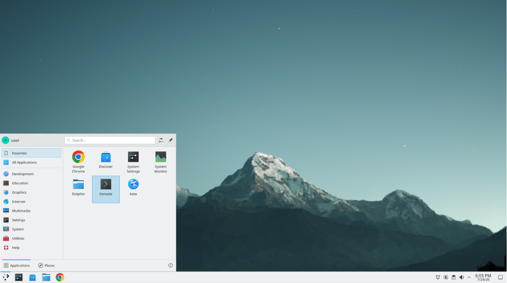

### Step 57: Launch the Universal Robot Example

In the terminal, navigate to the ROS 2 workspace, source the workspace overlay, and launch the Universal Robot simulation:

```
cd ../home/user/ros2_ws/
source install/setup.bash
ros2 launch slicer_ros2_module ur_sim_control.launch.py
```

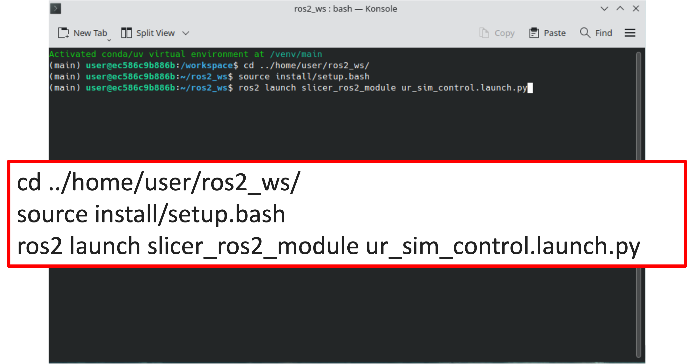

### Step 58: Confirm the Simulation Starts

Wait for the launch output to settle. You should see the controller manager load the joint trajectory, freedrive mode, and tool contact controllers, finishing with a message that the spawner process completed cleanly.

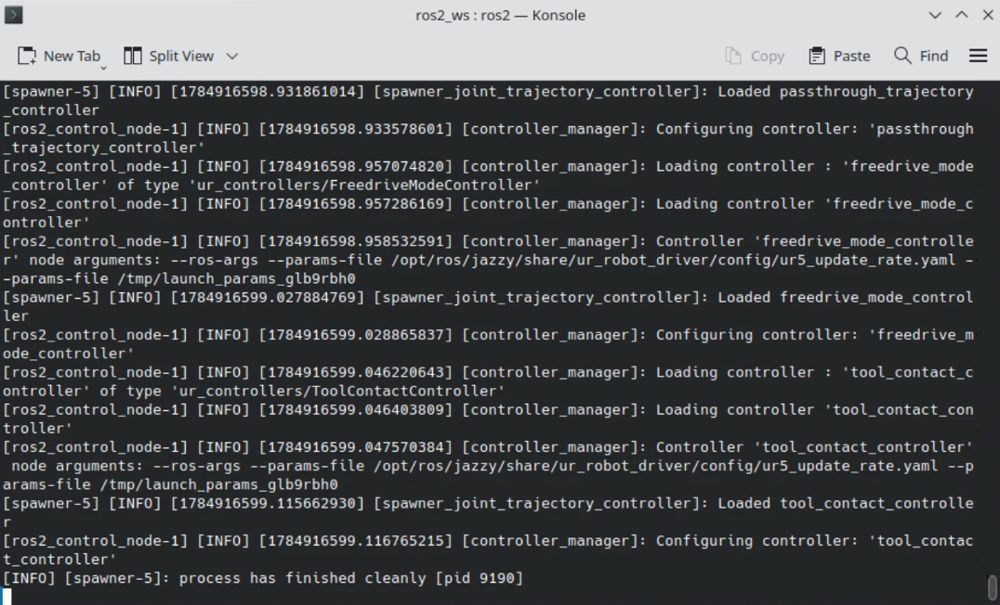

---

## Part 7: Launch SlicerROS2 and Load the Robot

### Step 59: Launch SlicerROS2

Open a new Konsole tab, source the workspace again, and launch 3D Slicer with the SlicerROS2 module:

```
cd ../home/user/ros2_ws/
source install/setup.bash
ros2 launch slicer_ros2_module slicer.launch.py
```

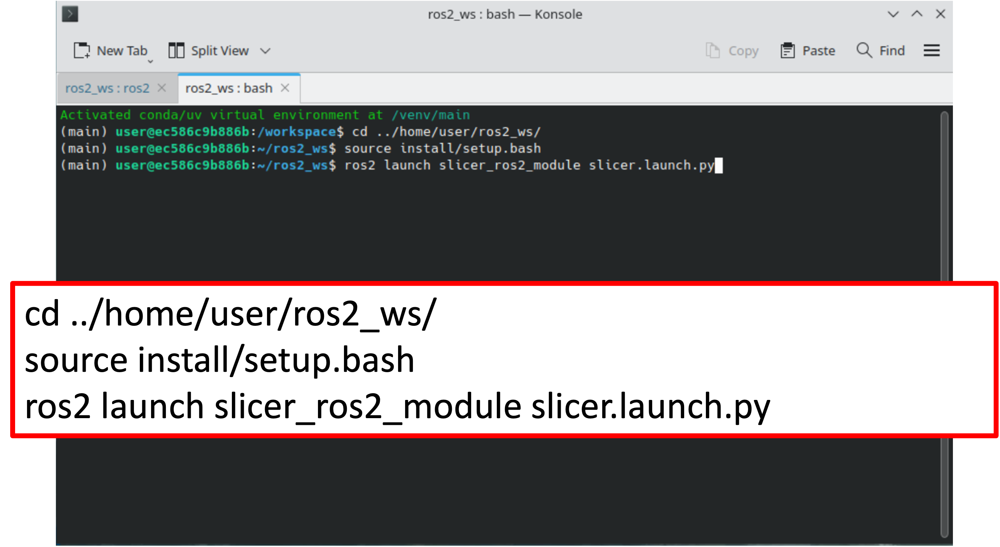

### Step 60: Confirm Slicer Opens

3D Slicer should open to the default Welcome module with an empty Four-Up layout.

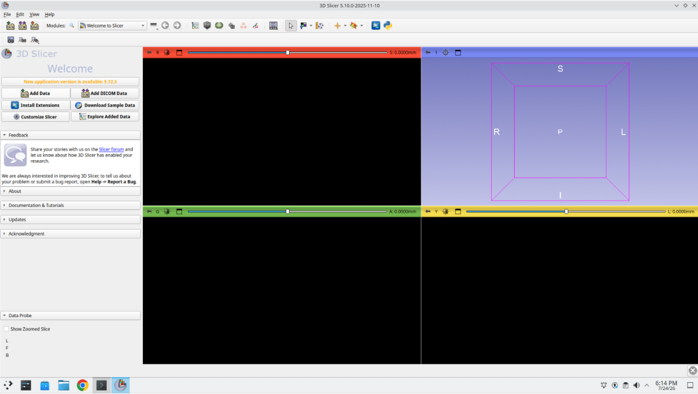

### Step 61: Open the Module Finder

Press **Ctrl+F** to open the Module Finder and search for **ros2**.

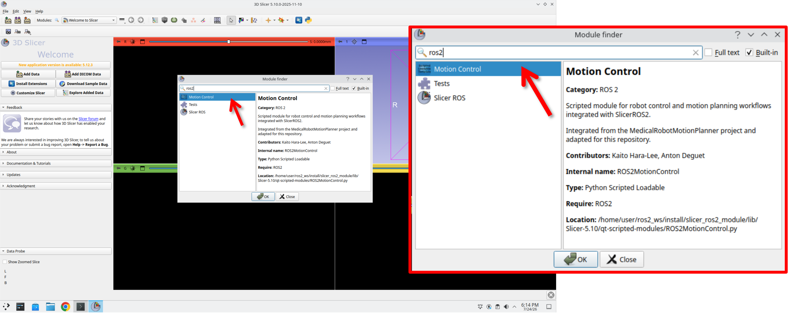

### Step 62: Open the Slicer ROS 2 Panel

Select **Motion Control** to load the module, then open the **Slicer ROS 2** collapsible section near the bottom of the panel.

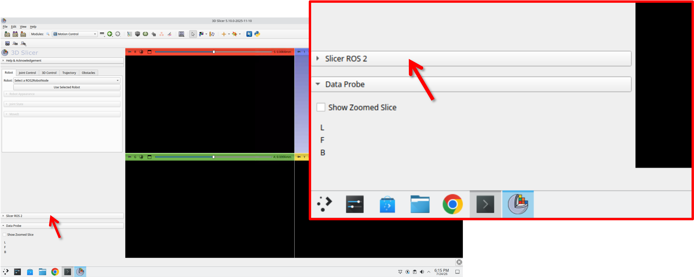

### Step 63: Add a New Robot

With the **Robots** tab selected, press **+ Add New Robot**.

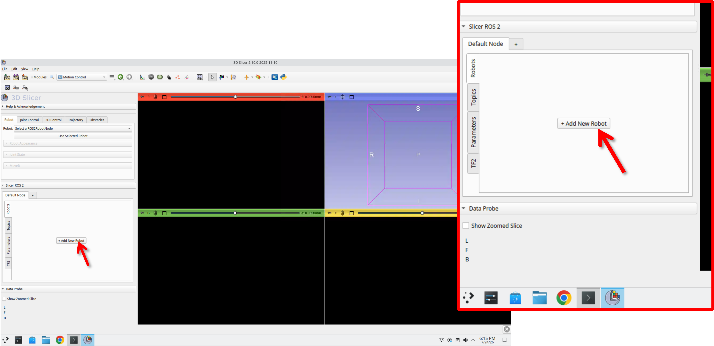

### Step 64: Load the Robot

Leave the default **Robot Name** (`robot1`), **Parameter Node Name**, and **Parameter Name** fields as they are, and press **Load Robot**.

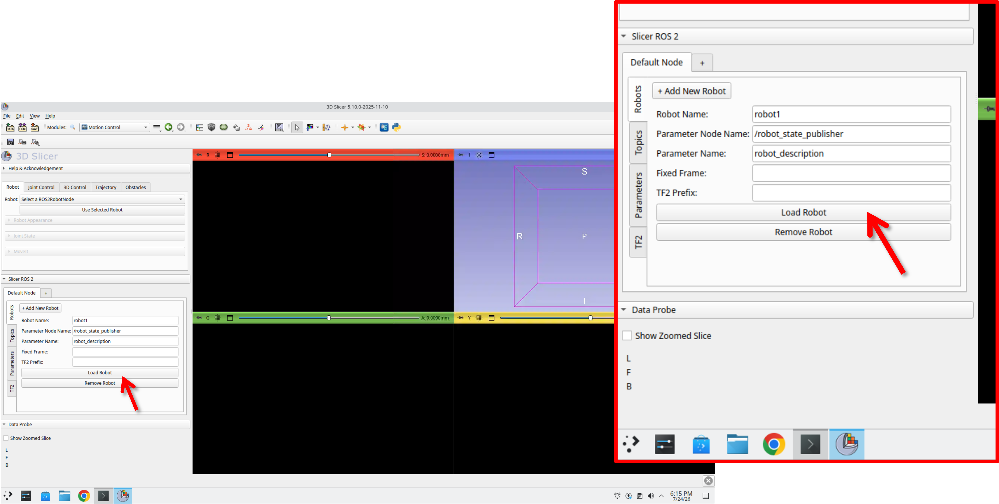

### Step 65: Confirm the Robot Loads

The **Robot** dropdown at the top of the module now shows **`ros2:robot:robot1`**, and the robot model appears in the 3D view.


### Step 66: Use the Selected Robot

Make sure **`ros2:robot:robot1`** is selected in the **Robot** dropdown, then press **Use Selected Robot**.


### Step 67: Confirm the Robot Controls Appear

The **Robot Appearance**, **Joint State**, and **MoveIt** sections expand, and the robot is now fully visible in the 3D view.

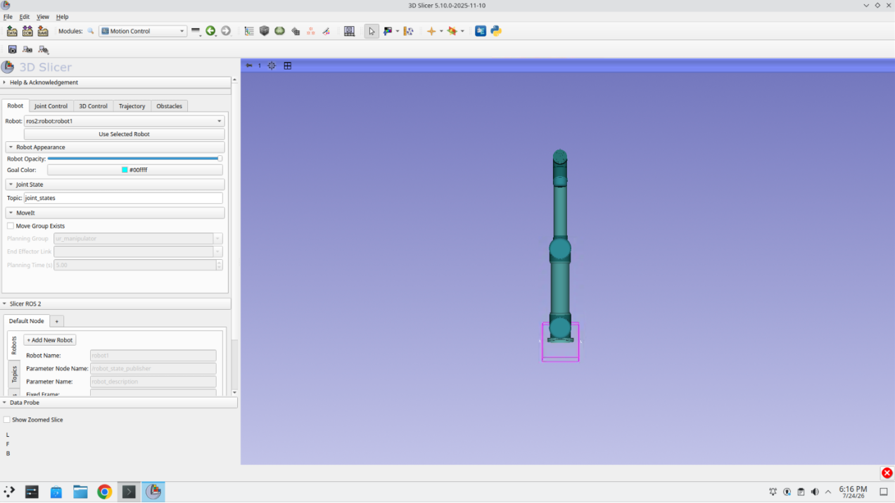

---

## Part 8: Explore the Motion Control Module

### Step 68: Explore Each of the Tabs

Take a moment to click through the **Robot**, **Joint Control**, **3D Control**, **Trajectory**, and **Obstacles** tabs to see what each one offers.

<video controls muted playsinline width="100%" poster="images/embc_68_explore_tabs_poster.png">
  <source src="images/embc_68_explore_tabs.mp4" type="video/mp4">
  Your browser does not support the video tag.
</video>

---

## Part 9: Add Patient Models and a Custom End-Effector

### Step 69: Clone the Tutorial Data

Open a new Konsole terminal and clone the repository containing the patient model and end-effector data:

```
cd ../home/user
git clone https://github.com/LauraConnolly/slicerros2_tutorial.git
```

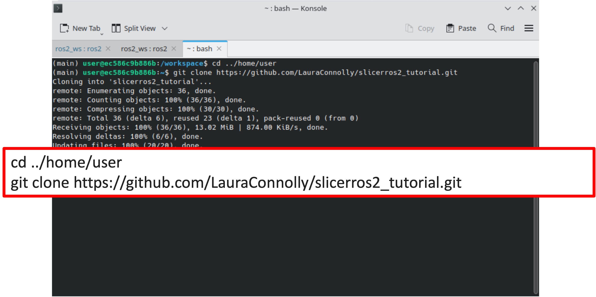

### Step 70: Load the Data

Back in Slicer, click the **Add Data** button, then select **Choose File(s) to Add** in the dialog that appears.

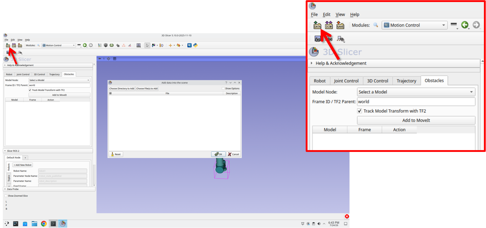

### Step 71: Select the Data Files

Navigate to the `data` folder inside the repository you just cloned (`/home/user/slicerros2_tutorial/data`) and select **Spine_and_EE.mrb**.

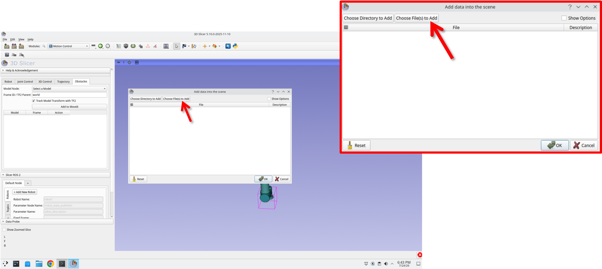

### Step 72: Confirm the Load

The MRB bundle is listed in the Add Data dialog. Press **OK** to load it into the scene.

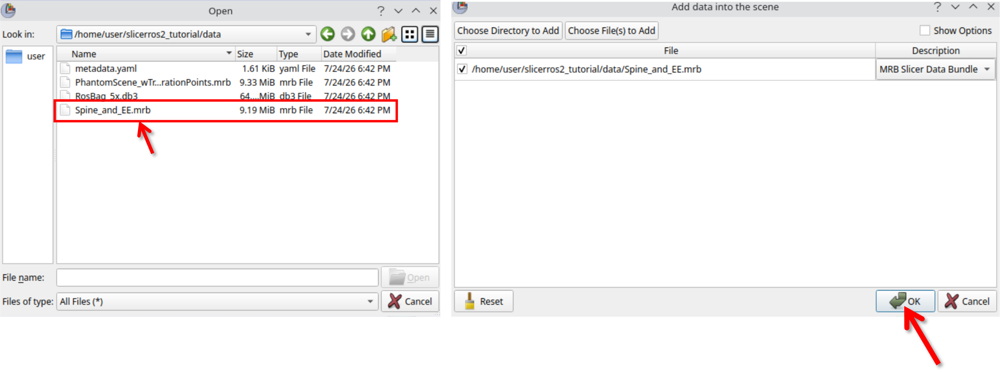

### Step 73: Confirm the Data Appears

The spine model and the custom end-effector model are now loaded into the scene, though not yet attached to the robot.

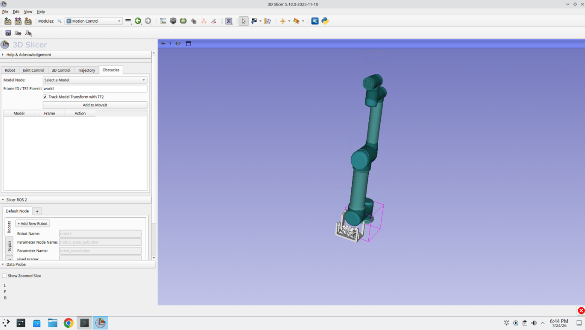

### Step 74: Open the Data Module

Press **Ctrl+F** again and search for the **Data** module.

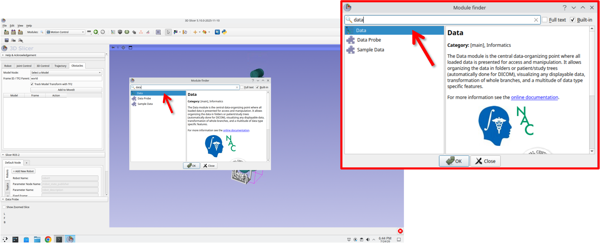

### Step 75: Open the Transform Hierarchy Tab

In the Data module, press the **Transform hierarchy** tab.

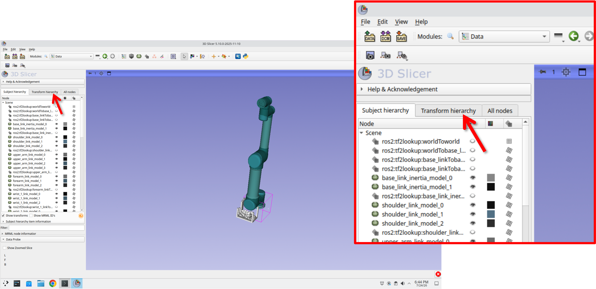

### Step 76: Expand the Transform Trees

Expand the robot's transform tree so you can see the individual link transforms, along with the loose **spine** and end-effector (**Transform**) nodes at the bottom of the list.

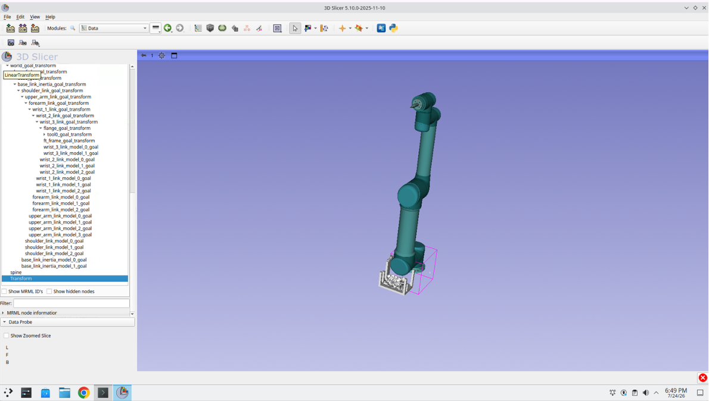

### Step 77: Drag Each Model to Its Location

Drag the **spine** node onto the appropriate frame in the transform tree, and drag the end-effector transform onto the robot's tool flange. Each model now moves and tracks with its assigned link.

<video controls muted playsinline width="100%" poster="images/embc_77_drag_models_poster.png">
  <source src="images/embc_77_drag_models.mp4" type="video/mp4">
  Your browser does not support the video tag.
</video>

### Step 78: Return to the Motion Control Module

Press the recent modules button in the toolbar and select **Motion Control** to switch back.

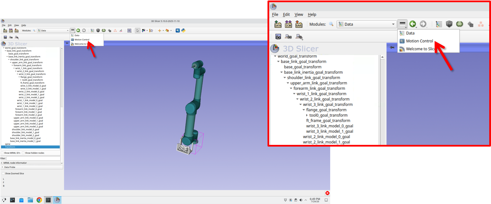

---

## Part 10: Motion Planning Around Patient Models

### Step 79: Add the Spine as an Obstacle

Select the **Obstacles** tab, then choose **spine** from the **Model Node** dropdown.

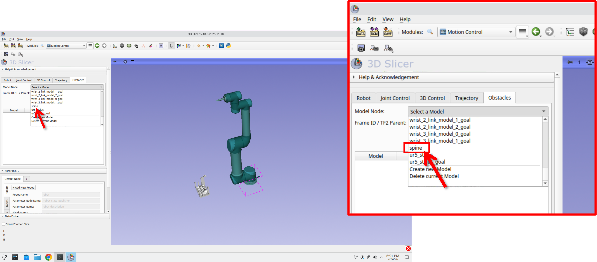

### Step 80: Confirm the Obstacle Is Added

Press **Add to MoveIt**. The spine model now appears in the obstacle table, and MoveIt begins planning around it.

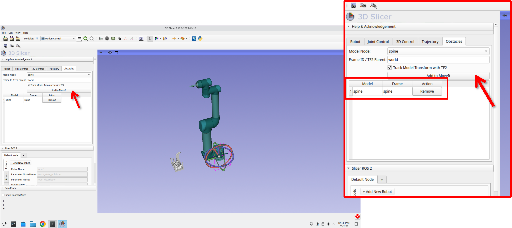

### Step 81: Plan a Trajectory

With the spine registered as an obstacle, use the interactive handles to plan a trajectory that touches key points on the spine model while avoiding collisions.

<video controls muted playsinline width="100%" poster="images/embc_81_plan_trajectory_poster.png">
  <source src="images/embc_81_plan_trajectory.mp4" type="video/mp4">
  Your browser does not support the video tag.
</video>

---

# Summary

In this session, you:

- Launched a simulated Universal Robot and connected it to 3D Slicer through SlicerROS2
- Loaded the robot into the Motion Control module and confirmed its controls
- Explored the Robot, Joint Control, 3D Control, Trajectory, and Obstacles tabs
- Loaded a patient spine model and a custom end-effector, and attached them to the robot's transform tree
- Registered the spine model as an obstacle in MoveIt
- Planned a robot trajectory that touches key points on the patient anatomy while avoiding collisions

<div class="tutorial-nav"><a href="tutorial_part2.html" class="btn-secondary">Back to Part 2</a><a href="tutorial_part4.html" class="btn-primary">Go to Next Step →</a></div>
